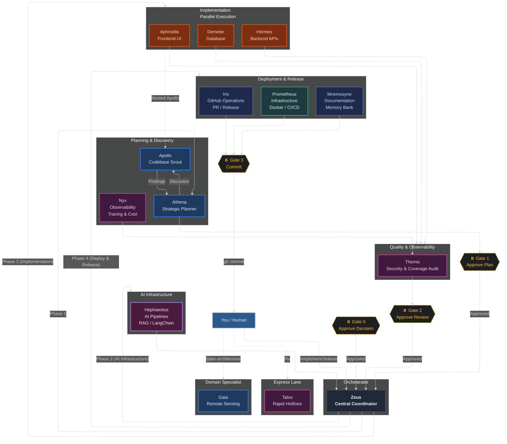

# Workflow: como uma feature atravessa o Pantheon

> Conteúdo da v4.0 (legacy), originalmente publicado no README raiz.

O sistema opera em fases definidas e controladas por você. Dentro de cada fase os
agentes trabalham em paralelo; toda transição é bloqueada até sua aprovação explícita.



---

## Approval gates

| Gate | Fase | O que acontece |
|---|---|---|
| **Gate 1** | Depois do planejamento | Athena apresenta um plano TDD em fases. Você revisa e aprova (ou pede mudanças) antes de qualquer código ser escrito. |
| **Gate 2** | Depois da implementação e revisão | Themis audita todos os arquivos alterados para OWASP, cobertura >80% e qualidade. Você valida o que só você pode julgar. |
| **Gate 3** | Depois da preparação de deploy | O agente sugere uma mensagem de commit. Você executa `git commit` manualmente e decide quando fazer merge. |

---

## Fluxo padrão de uma feature

```
User → Zeus: "Implement email verification"


1. PLAN:       Zeus → Athena → Apollo → Athena → USER (approve gate 1)
2. AI INFRA:   Zeus → Hephaestus (if AI components needed)
3. BUILD:      Zeus → Hermes + Aphrodite + Demeter (parallel execution)
4. OBSERVE:    Nyx instruments tracing, cost, and metrics
5. REVIEW:     Themis audits all code → USER (approve gate 2)
6. DEPLOY:     Prometheus (infra) + Iris (release) + Mnemosyne (docs)
7. COMMIT:     USER (git commit gate 3)
```

---

## Invocação direta

Agentes também podem ser chamados diretamente para tarefas focadas:

```
@apollo: Find all authentication-related files and usages
@hermes: Create POST /products endpoint with cursor pagination
@aphrodite: Refactor ProductCard for WCAG AA compliance
@demeter: Analyze and fix N+1 queries on orders table
@hephaestus: Build a RAG pipeline with pgvector for product docs
@nyx: Set up OpenTelemetry tracing for the payment service
@themis: Review this PR for security vulnerabilities
@iris: Create branch feat/search and open a draft PR
@gaia: Analyze agreement metrics between MapBiomas and ESA WorldCover
```

---

## Hotfix express lane

Para correções triviais (typos de CSS, bugs simples de lógica), pule a orquestração completa:

```
@talos: Fix the missing breakpoint class on MobileMenuButton
```

Talos trabalha sozinho, sem subagentes e sem cerimônia de TDD. Se o problema crescer,
ele escala para Zeus.
